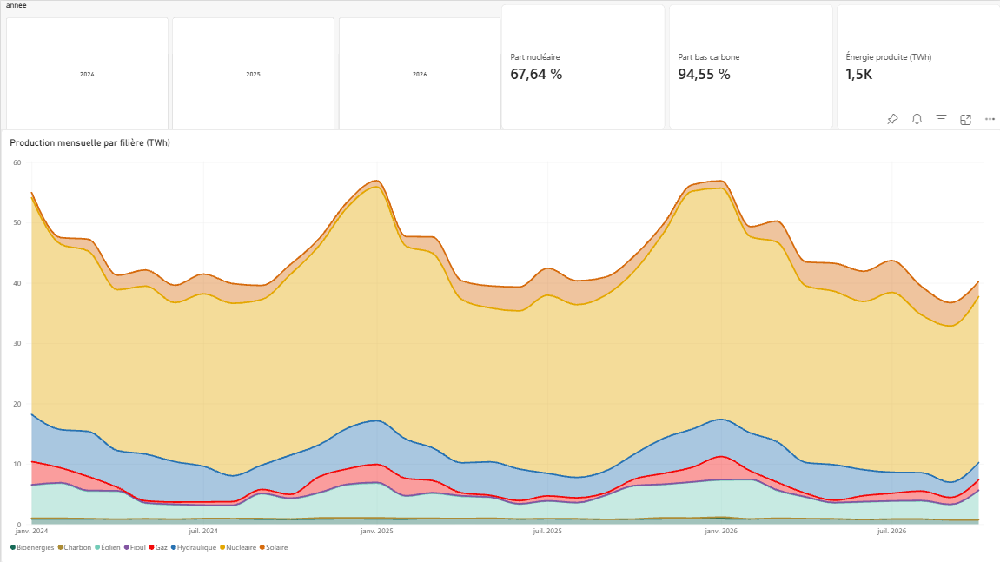
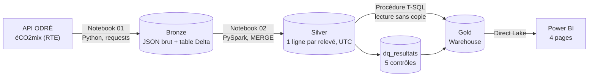
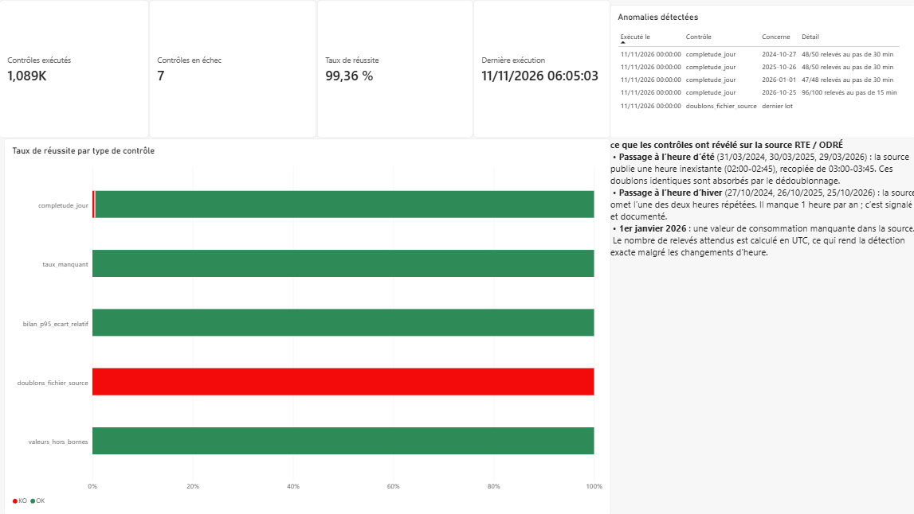
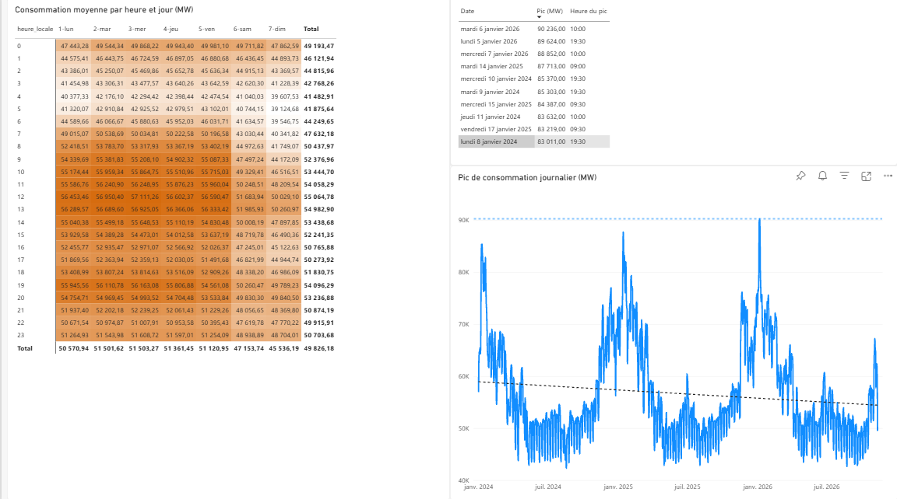
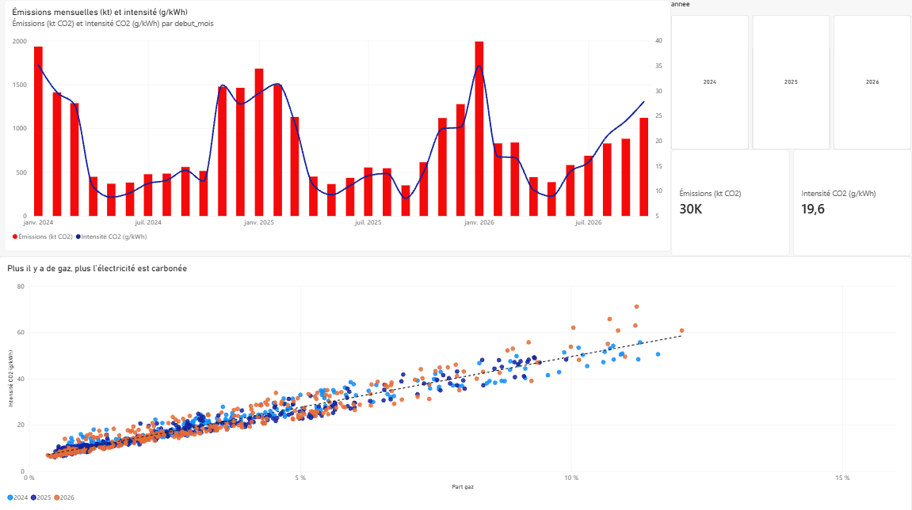

# Pipeline de données énergétiques sur Microsoft Fabric

Chaque matin, un pipeline Microsoft Fabric récupère les données du système électrique français publiées par RTE (éCO2mix), les nettoie et les contrôle en PySpark, construit un modèle en étoile en T-SQL, puis alimente un rapport Power BI en Direct Lake.



**En bref**

- Architecture médaillon (bronze, silver, gold) : Lakehouse, notebooks PySpark, tables Delta, Warehouse T-SQL.
- Gestion des révisions de la source : un `MERGE` qui ne remplace jamais une donnée par une version moins fiable.
- Cinq contrôles qualité automatisés, historisés et visibles dans le rapport. Ils ont révélé trois défauts réels de la source.
- Résultats validés contre le bilan électrique officiel de RTE : moins de 2 % d'écart sur la consommation.
- Rapport Power BI de quatre pages : mix énergétique, pics de consommation, CO₂, qualité des données.

## Architecture



Un pipeline Fabric enchaîne chaque jour à 7 h : notebook 01 → notebook 02 → attente de 60 s → procédure stockée. Durée totale : environ 3 minutes et demie.

| Brique | Rôle |
| --- | --- |
| Lakehouse `lh_eco2mix` | Bronze, silver et résultats des contrôles, en Delta dans OneLake |
| Notebooks PySpark | Ingestion, nettoyage, dédoublonnage, `MERGE`, contrôles qualité |
| Warehouse `wh_eco2mix` | Couche gold en T-SQL (tables CTAS), lecture inter-bases du lakehouse sans copie |
| Pipeline `pl_eco2mix_quotidien` | Planification, enchaînement, nouvelles tentatives, session Spark partagée |
| Modèle sémantique `sm_eco2mix` | Direct Lake, schéma en étoile, 14 mesures DAX |
| Rapport Power BI | Quatre pages d'analyse |

## Les données

[éCO2mix](https://odre.opendatasoft.com/) est la donnée publique de RTE sur le système électrique français : consommation, production par filière, échanges aux frontières et taux de CO₂. Elle est récupérée par l'API Opendatasoft du portail ODRÉ, endpoint `/exports`, en un seul appel par exécution.

| Jeu | Niveau de fiabilité | Pas de temps | Période chargée |
| --- | --- | --- | --- |
| `eco2mix-national-cons-def` | Définitif, puis consolidé | 30 min | 01/01/2024 → 31/08/2026 |
| `eco2mix-national-tr` | Temps réel | 15 min | 01/09/2026 → aujourd'hui |

La table silver contenait **53 566 relevés** après le chargement initial, sans trou entre les deux jeux.

## Choix techniques

**Un bronze en texte.** Les deux jeux RTE ne typent pas toujours une colonne de la même façon (nombre dans l'un, texte dans l'autre), ce qui faisait échouer l'ajout. Le bronze garde donc toutes les colonnes en texte, avec trois colonnes de traçabilité (`_ingested_at`, `_source_file`, `_dataset`). Chaque réponse de l'API est aussi conservée comme fichier JSON immuable, pour pouvoir tout rejouer sans rappeler l'API.

**Une clé en UTC.** La nuit du passage à l'heure d'hiver, l'heure entre 2 h et 3 h existe deux fois en heure locale. La clé de la table silver est donc l'horodatage UTC ; l'heure locale n'est qu'une colonne d'affichage.

**Un `MERGE` qui respecte la fiabilité.** RTE révise ses chiffres : temps réel, puis consolidé, puis définitif. Chaque ligne porte une priorité (1, 2 ou 3). Le `MERGE` ne met à jour une valeur que si la nouvelle version est au moins aussi fiable, et une fenêtre glissante de 3 jours récupère les corrections récentes.

```python
(DeltaTable.forName(spark, "silver_eco2mix").alias("t")
    .merge(silver_batch.alias("s"), "t.ts_utc = s.ts_utc")
    .whenMatchedUpdateAll(condition="s.priorite_nature >= t.priorite_nature")
    .whenNotMatchedInsertAll()
    .execute())
```

**Le pas de temps de chaque jour.** L'historique est au pas de 30 minutes, le temps réel au pas de 15 minutes. Le silver calcule le pas de chaque jour (`pas_min`), indispensable pour convertir des puissances (MW) en énergies (MWh) : sans lui, l'énergie de l'historique serait divisée par deux.

**Un gold fait de tables, pas de vues.** Direct Lake lit des tables Delta ; une vue ferait basculer Power BI en DirectQuery. La procédure `gold.sp_rafraichir` reconstruit cinq tables (faits de production et de consommation, synthèse journalière, dimension date, résultats qualité) en environ 15 secondes.

**Une session Spark partagée.** La capacité d'essai refusait la deuxième session Spark du pipeline (erreur HTTP 430). Avec la haute simultanéité et une étiquette de session commune, les deux notebooks partagent une seule session : le notebook silver démarre immédiatement.

## Qualité des données

Après chaque fusion, cinq contrôles sont exécutés et historisés dans `dq_resultats`. Un contrôle en échec n'arrête pas le pipeline : il est enregistré et apparaît dans la page Qualité du rapport.

| Contrôle | Question | Seuil |
| --- | --- | --- |
| `completude_jour` | Chaque jour a-t-il tous ses relevés ? Nombre attendu calculé en UTC : 92, 96 ou 100 au pas de 15 min | 100 % |
| `taux_manquant` | Part de valeurs vides par filière | ≤ 1 % |
| `bilan_p95_ecart_relatif` | Consommation ≈ production + échanges + stockage (95e centile de l'écart) | ≤ 2 % |
| `valeurs_hors_bornes` | Valeurs physiquement impossibles | 0 |
| `doublons_fichier_source` | Un même horodatage deux fois dans un fichier | 0 |

Au 11/11/2026 : **1 089 contrôles exécutés, 99,4 % de réussite.** Le contrôle de bilan passe, ce qui valide les conventions de signe des échanges et du stockage.

### Ce que les contrôles ont révélé sur la source

| Constat | Dates | Effet | Traitement |
| --- | --- | --- | --- |
| Au passage à l'heure d'été, la source publie une heure inexistante (02:00-02:45), recopiée de 03:00-03:45 | 31/03/2024, 30/03/2025, 29/03/2026 | Doublons identiques | Absorbés par le dédoublonnage du silver |
| Au passage à l'heure d'hiver, la source omet l'une des deux heures répétées | 27/10/2024, 26/10/2025, 25/10/2026 | 1 heure manquante par an | Signalé et documenté |
| Une valeur de consommation manquante | 01/01/2026 | 1 relevé sur 48 | Signalé et documenté |



## Validation contre le bilan électrique RTE 2024

| Indicateur 2024 | Ce projet | Bilan RTE 2024 | Explication de l'écart |
| --- | --- | --- | --- |
| Consommation | 440,0 TWh | 449,2 TWh | RTE publie une consommation corrigée des aléas météo ; 2024 a été une année douce |
| Émissions de la production | 10,8 Mt CO₂ | 11,7 Mt CO₂eq | Estimation temps réel en CO₂ contre bilan consolidé en CO₂ équivalent |
| Intensité carbone | 20,1 g/kWh | 21,7 g CO₂eq/kWh | Même raison |
| Part du nucléaire | 67 % | — | — |
| Part bas carbone | 94,5 % (2024-2026) | 95 % | — |

Sources : [RTE, Bilan électrique 2024](https://analysesetdonnees.rte-france.com/en/annual-review-2024/keyfindings) · [Connaissance des Énergies, « 95 % d'électricité bas carbone en 2024 »](https://www.connaissancedesenergies.org/electricite-rte-annonce-un-nouveau-record-en-france-en-2024)

## Ce que montrent les données

**La consommation suit une courbe de charge marquée.** Les pics d'hiver atteignent 85 à 90 GW, avec un record de **90 236 MW le 6 janvier 2026 à 10 h**, contre environ 50 GW l'été. En semaine, la consommation culmine vers midi et vers 19 h, et elle est inférieure de 4 à 6 GW le week-end.



**Le gaz explique l'intensité carbone.** Chaque jour placé selon sa part de gaz et son intensité carbone forme une droite presque parfaite : chaque point de gaz ajoute environ 4,5 g de CO₂ par kWh. Cela correspond à environ 450 g/kWh pour une centrale à gaz, l'ordre de grandeur réel de cette technologie : les données retrouvent le facteur d'émission du gaz.



## Structure du dépôt

```
eco2mix-fabric/
├── README.md
├── notebooks/
│   ├── 01_bronze_ingestion.ipynb   API → fichier JSON brut + table bronze
│   └── 02_silver_qualite.ipynb     typage, UTC, dédoublonnage, MERGE, 5 contrôles
├── sql/
│   └── 03_gold_warehouse.sql       schéma gold et procédure gold.sp_rafraichir
├── pipeline/
│   └── README.md                   activités, réglages, session partagée
├── powerbi/
│   └── mesures_dax.md              relations, mesures DAX, requêtes de test
└── docs/img/                       captures du rapport
```

## Reproduire le projet

1. Créer un espace de travail Fabric (essai ou capacité F), puis un lakehouse `lh_eco2mix` sans schémas.
2. Importer les deux notebooks et leur attacher le lakehouse comme lakehouse par défaut.
3. **Chargement historique :** exécuter `01_bronze_ingestion` avec `dataset = "eco2mix-national-cons-def"` et `date_debut = "2024-01-01"`, puis avec `dataset = "eco2mix-national-tr"` et `date_debut` égal au lendemain de la fin de l'historique consolidé.
4. Exécuter `02_silver_qualite` avec `fenetre_jours` couvrant tout l'historique (1046 au 11/11/2026), puis remettre les paramètres par défaut des deux notebooks (`date_debut = ""`, `fenetre_jours = 5`).
5. Créer un entrepôt `wh_eco2mix`, y ajouter le lakehouse, puis exécuter `sql/03_gold_warehouse.sql`.
6. Créer le pipeline décrit dans `pipeline/README.md` et le planifier.
7. Créer le modèle sémantique Direct Lake sur les tables `gold` et ses mesures (`powerbi/mesures_dax.md`), puis le rapport.

## Limites et suites possibles

- Le gold est reconstruit entièrement chaque jour : suffisant pour environ 35 000 relevés par an. Un chargement incrémental s'imposerait sur des volumes plus importants.
- Maille nationale uniquement. Le jeu `eco2mix-regional-tr` permettrait une dimension région, avec une sécurité au niveau des lignes par région.
- Les contrôles en échec ne déclenchent pas d'alerte. Une règle Activator ou un message Teams sur `statut = 'KO'` compléterait le dispositif.
- Pas de maintenance des tables Delta : un `OPTIMIZE` et un `VACUUM` hebdomadaires seraient nécessaires à long terme.
- Le versionnement Git natif de Fabric n'était pas disponible sur le tenant utilisé ; le code est exporté manuellement dans ce dépôt.

## Auteur

Younes El Majdoubi El Idrissi, élève-ingénieur en IA et Big Data · [LinkedIn](https://www.linkedin.com/in/younes-el-majdoubi-el-idrissi)
